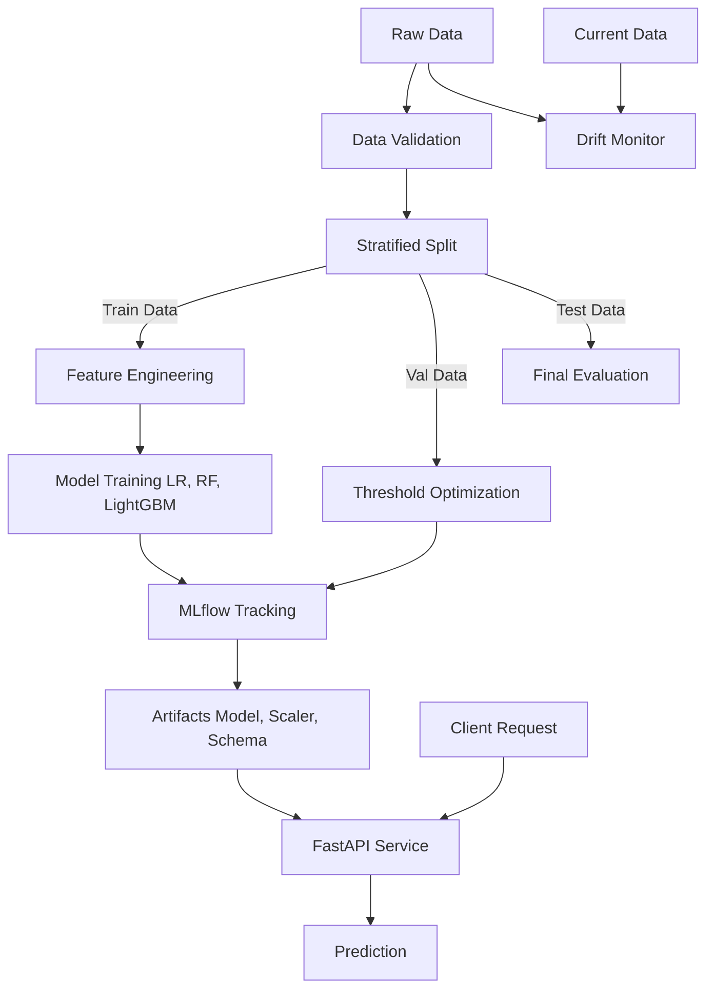

# TransactionGuard: Imbalanced Fraud Detection

## Primary local web application

TransactionGuard's primary interface is a custom React, TypeScript, Three.js, and FastAPI application. It provides a responsive 3D product experience, CSV/Excel batch analysis, single-transaction review, local result export, and a synthetic-data model-intelligence view. The legacy Streamlit dashboard remains available in `app.py` for now, but is not required by the new application.

Start the API in one PowerShell terminal:

```powershell
.\venv\Scripts\Activate.ps1
pip install -r requirements.txt
uvicorn app.main:app --reload --port 8000
```

Start the web interface in another:

```powershell
cd frontend
npm install
npm run dev
```

Open the Vite address printed in the terminal (normally `http://localhost:5173`). The frontend expects the local API at `http://localhost:8000/api`; override that only when needed with `VITE_API_BASE_URL`.

## Legacy Streamlit browser application

TransactionGuard includes a local Streamlit dashboard for reviewing model estimates. It supports CSV and Excel batch uploads, a single-transaction form, downloadable results, session-only dashboards, and the available saved evaluation report.

```powershell
.\venv\Scripts\Activate.ps1
pip install -r requirements.txt
streamlit run app.py
```

Open the local address Streamlit prints (normally `http://localhost:8501`). The application never uploads transaction records to an external service and does not persist uploaded files.

### Upload schema

The saved model requires these 30 numeric columns: `Time`, `V1` through `V28`, and `Amount`. Download the input template from **Bulk Analysis** to guarantee the correct schema. `Class`, if present, is treated only as optional evaluation information; it is not passed to the model. Other columns such as a transaction ID are preserved in downloaded results but are not model inputs.

The decision threshold comes from the saved artifact and is intentionally not the default 50%. A fraud probability, the binary fraud flag, and the visual risk band are separate concepts. All output is a screening estimate for review, never a confirmation of fraud.

### Troubleshooting the UI

* **Missing model artifacts:** run `python scripts/train.py` from an activated environment, then restart Streamlit.
* **Excel upload/export unavailable:** install `openpyxl` with `pip install -r requirements.txt`.
* **Validation error:** ensure every required model feature is present, numeric, finite, and non-empty. The dashboard does not invent or fill missing features.

The bundled scores are from deliberately separable synthetic data and must not be presented as evidence of real-world fraud-detection performance.

## 1. Project Overview

**TransactionGuard** is an end-to-end machine learning system designed to detect potentially fraudulent financial transactions within highly imbalanced datasets. The system rigorously prevents data leakage, evaluates multiple classifiers based on Average Precision (PR-AUC), and sets classification thresholds driven by business costs. It includes an automated drift detection pipeline, and serves inferences via a fast, containerized API.

## 2. Problem Statement and Class Imbalance

Fraud detection problems are fundamentally characterized by extreme class imbalance. In this scenario, legitimate transactions overwhelmingly outnumber fraudulent ones (often by 99.8% to 0.2%). Models evaluated purely on overall accuracy can appear highly performant while failing to detect any actual fraud.

This project tackles this by:
* Using **Average Precision (PR-AUC)** as the primary selection metric.
* Employing stratified splitting to preserve class proportions across training, validation, and untouched test sets.
* Calculating class weights based solely on training data.
* Using a validation dataset to pick the decision threshold that minimizes business costs, rather than relying on a default 0.5 threshold.

## 3. Architecture Diagram



## 4. Technology Stack

* **Python 3.11+**
* **Data Processing & ML:** `pandas`, `numpy`, `scikit-learn`, `lightgbm`, `scipy`
* **Tracking & Persistence:** `mlflow`, `joblib`
* **API Service:** `fastapi`, `pydantic`, `uvicorn`
* **Visualization:** `matplotlib`, `seaborn`
* **Quality & CI:** `pytest`, `ruff`, GitHub Actions
* **Deployment:** Docker, Docker Compose

## 5. Repository Structure

```
TransactionGuard/
├── app/                  # FastAPI service implementation
├── artifacts/            # Trained models and schemas (persisted here)
├── data/                 # Raw, processed, and reference data
├── mlruns/               # MLflow tracking data
├── reports/              # Generated plots, metrics, and drift summaries
├── scripts/              # CLI scripts for training, eval, and data loading
├── src/transactionguard/ # Core reusable machine learning logic
├── tests/                # Pytest unit and API test suite
├── .github/workflows/    # CI/CD configurations
├── Makefile              # Task runner
├── Dockerfile            # Container configuration
├── docker-compose.yml    # Service configuration
└── pyproject.toml        # Dependency and tooling configs
```

## 6. Dataset Source and Setup

The project is configured to use the [Kaggle Credit Card Fraud Detection](https://www.kaggle.com/datasets/mlg-ulb/creditcardfraud) dataset.

### Manual Download (Recommended)
1. Go to the dataset page above and download the archive.
2. Extract the `creditcard.csv` file.
3. Place `creditcard.csv` in `data/raw/creditcard.csv`.

### Using the CLI
If you have your `kaggle.json` configured in your environment:
```bash
python scripts/download_data.py
```

### Synthetic Demo Data
If the Kaggle dataset is unavailable, you can generate a synthetic substitute for smoke-testing:
```bash
make demo
```

## 7. Environment Setup

### Linux / macOS
```bash
python3 -m venv venv
source venv/bin/activate
make setup
```

### Windows PowerShell
```powershell
python -m venv venv
.\venv\Scripts\Activate.ps1
pip install -r requirements.txt
pip install -e .[dev]
```

## 8. Training Commands

The training pipeline loads data, validates it, splits it, runs feature engineering, trains three models (Logistic Regression, Random Forest, LightGBM), selects the optimal business threshold on validation data, logs to MLflow, and saves the best model artifacts.

```bash
make train
# Or manually: MLFLOW_ALLOW_FILE_STORE=true PYTHONPATH=src python scripts/train.py
```

## 9. Evaluation Commands

Evaluates the saved model artifact strictly on the held-out test partition.
```bash
make evaluate
# Or manually: PYTHONPATH=src python scripts/evaluate.py
```

## 10. Threshold Optimization and Cost Assumptions

Threshold selection does not default to 0.5. Instead, it minimizes a configurable cost function based on the validation set predictions:
* **False Negative Cost (`FN_COST`):** Default 1000.0 (High cost of missing fraud).
* **False Positive Cost (`FP_COST`):** Default 10.0 (Cost of investigating a legitimate user).

## 11. MLflow Startup and Inspection

Start the MLflow tracking UI to view experiments:
```bash
mlflow ui --backend-store-uri file://$(pwd)/mlruns
```
Then visit `http://127.0.0.1:5000`.

## 12. Drift-Report Generation

Compares current data distributions to reference data using the KS-test.
```bash
make drift
# Or manually: PYTHONPATH=src python scripts/generate_drift_report.py
```
Reports are output to `reports/drift_summary.json` and `reports/drift_features.csv`.

## 13. API Startup Commands

Run the FastAPI inference service locally:
```bash
make run-api
```
The API expects the model artifacts to be present in the `artifacts/` directory.

## 14. Docker Build and Run

To run the API reproducibly using Docker:
```bash
# Build
make docker-build
# Run
make docker-run
```
Alternatively, using Docker Compose:
```bash
docker-compose up --build
```

## 15. Swagger Documentation

Once the API is running, the interactive Swagger documentation is available at:
`http://localhost:8000/docs`

## 16. Example Request

```bash
curl -X 'POST' \
  'http://localhost:8000/predict' \
  -H 'accept: application/json' \
  -H 'Content-Type: application/json' \
  -d '{
  "Time": 0,
  "V1": -1.359,
  "V2": -0.072,
  "V3": 2.536,
  "V4": 1.378,
  "V5": -0.338,
  "V6": 0.462,
  "V7": 0.239,
  "V8": 0.098,
  "V9": 0.363,
  "V10": 0.090,
  "V11": -0.551,
  "V12": -0.617,
  "V13": -0.991,
  "V14": -0.311,
  "V15": 1.468,
  "V16": -0.470,
  "V17": 0.207,
  "V18": 0.025,
  "V19": 0.403,
  "V20": 0.251,
  "V21": -0.018,
  "V22": 0.277,
  "V23": -0.110,
  "V24": 0.066,
  "V25": 0.128,
  "V26": -0.189,
  "V27": 0.133,
  "V28": -0.021,
  "Amount": 149.62
}'
```

## 17. Testing Commands

Run the full pytest suite:
```bash
make test
# Or manually: PYTHONPATH=src:. pytest
```

## 18. Measured Results Table (Synthetic Demo)

*Note: The following metrics were collected on the synthetic demo dataset.*

| Metric                               | Result (Logistic Regression, Selected) |
| ------------------------------------ | -------------------------------------: |
| Validation Average Precision         |                                 1.0000 |
| Test Average Precision               |                                 1.0000 |
| Test ROC-AUC                         |                                 1.0000 |
| Test Precision at selected threshold |                                 0.9875 |
| Test Recall at selected threshold    |                                 1.0000 |
| Test F1 at selected threshold        |                                 0.9937 |
| False Positives                      |                                      1 |
| False Negatives                      |                                      0 |

*(Note: LightGBM achieved 0.9627 PR-AUC, Random Forest 1.0000 PR-AUC. Logistic Regression was selected as best based on the specific synthetic generation pattern.)*

## 19. Limitations and Responsible Use

* This is a demonstration project, **not a certified production banking system**.
* False positives inconvenience legitimate customers; real deployments require manual review pipelines.
* The explicit cost-matrix optimization utilizes illustrative defaults ($1000 per false negative, $10 per false positive). Real business costs vary wildly.
* Sensitive transaction data must not be logged unnecessarily in the API.

## 20. Troubleshooting

* **Model Loading Errors (API):** Ensure you have run `make train` successfully so that artifacts exist in `./artifacts`.
* **MLflow Errors:** If tracking fails, prefix commands with `MLFLOW_ALLOW_FILE_STORE=true`.
* **ModuleNotFoundError:** Ensure your `PYTHONPATH` includes `src` and you've installed with `pip install -e .[dev]`.

## 21. Reproducibility

To perfectly reproduce the data split and model behaviors, the `transactionguard.config` module uses `RANDOM_STATE = 42`. Ensure that dependencies in `requirements.txt` remain appropriately constrained.
